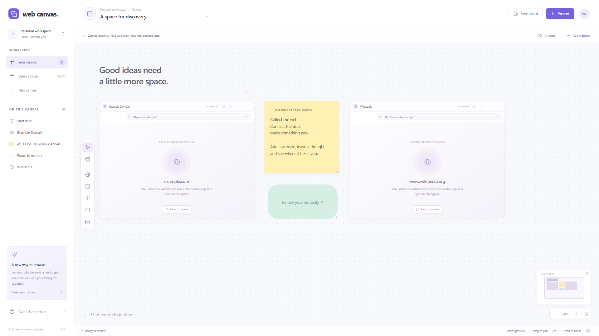

# Web Canvas

A Windows-first spatial browser: collect live websites, notes, text, shapes, and images on one pan-and-zoom canvas. Electron hosts real Chromium pages in `WebContentsView` instances; there are no website iframes or security-header workarounds.

The [logo](src/assets/logo.svg) uses two overlapping browser windows on a purple canvas. Available as an [SVG wordmark](src/assets/logo-wordmark.svg) and [single-color mark](src/assets/logo-monochrome.svg); open the [identity preview](docs/assets/logo-preview.html) or [PNG overview](docs/assets/logo-preview.png) to compare sizes and colors. The wordmark uses Segoe UI with an Arial fallback. The app sidebar, favicon, and presentation header share the primary mark.



*Canvas-only preview with website placeholders. Live websites run in the desktop app.*

## Run

Requires Node.js 22.12+ and Windows 10/11. Development is designed to run on macOS/Linux too; those platforms have not been verified.

```powershell
npm install
npm start
```

Development dependencies are Electron and `rcedit`, which embeds the Windows executable icon and version information during packaging. Installation downloads Electron's desktop runtime from the network. Use `npm ci` to install the versions recorded in `package-lock.json`.

For a **canvas-only preview**, with no dependency installation:

```powershell
npm run dev
```

Open `http://127.0.0.1:4173`. This preview supports canvas editing, presentation, local recovery, and board import/export. It deliberately displays placeholders for websites: use the desktop app for live browsing.

## Use the canvas

- **Add website** or `W`: enter an HTTP(S) URL. Each card has back, forward, reload, an address bar, Focus, and Close.
- Drag browser headers or annotation bodies to move; drag the lower-right corner to resize. Select an object to change its color, duplicate it, or remove it.
- Drag empty canvas to pan. Use the hand tool (`H`) or hold Space to pan over cards. Ctrl + wheel zooms; `F` fits the board. Wheel events inside a live website belong to that website.
- Add notes (`N`), text (`T`), shapes (`S`), or PNG/JPEG/WebP images (`I`, up to 5 MB each). Double-click notes, text, and shapes to edit. Escape or Ctrl + Enter finishes editing.
- Save (`Ctrl+S`), Save As (`Ctrl+Shift+S`), and Open (`Ctrl+O`) use `.webcanvas` JSON files. Layout, camera, sizes, order, text, images, and current URLs persist. Cookies, page history, form contents, scroll positions, and snapshots do not.
- The latest board is also kept in local recovery. Desktop recovery is under Electron's `userData` directory (`%APPDATA%/web-canvas` by default); preview recovery uses browser localStorage. Recovery is plaintext and is replaced as you edit another board. Board files can contain private URLs and image data.
- **Present** (`P`) walks through objects in list order. Use the arrows or on-screen controls; Escape returns to the canvas. Browsing controls remain available. Selecting/dragging an object normally raises it and changes its list order; presentation does not change that order.
- Undo/redo (`Ctrl+Z`, `Ctrl+Shift+Z`) covers object edits and layout changes. It does not undo website interactions or restore closed browser sessions.

## Live views and zoom

The canvas zoom range is **25–175%**. Fully contained, uncovered browser content is live at **50–175%**. Multiple eligible websites remain interactive simultaneously. Chromium's page zoom tracks the canvas scale; pages re-render and may reflow rather than behaving like a perfectly scaled screenshot.

Below 50%, while moving/resizing/panning, behind higher objects or floating tools, or partially outside the viewport, a card shows a **snapshot**. Playing media on the visible canvas refreshes approximately once per second, including muted video and when the app loses focus. Other snapshots refresh approximately every eight seconds; media also uses this slower schedule when off the canvas or the window is minimized/hidden. Preview refreshes are best-effort and protected content may remain blank. Use a live card for smooth video playback.

Background pages keep rendering so video does not freeze when a card loses focus or becomes a snapshot. They can continue scripts, audio, and network traffic. This uses more CPU/GPU and battery than throttling hidden pages; close unused cards to release their resources.

**Focus to browse** centers a card and brings it above other objects. In presentation, the current stop is raised visually without changing the saved order. The same live/snapshot rules apply; very large cards may need resizing or a larger app window. All native pages hide while an app dialog or text editor is open. This is an explicit MVP compromise for native view layering, clipping, and input handling.

## Security and compatibility

Remote pages have sandboxing and context isolation enabled, Node integration disabled, no preload, and separate in-memory sessions. The trusted local shell has a narrow, caller-checked IPC bridge and restrictive CSP. Normal certificate validation and web security remain enabled. Explicit `http://` addresses are supported for legacy/local sites and are unencrypted.

Permissions are denied by default: camera, microphone, geolocation, notifications, device access, and screen capture are unavailable. Popups, downloads, HTTP authentication, and external protocols are blocked with an explanation. Sites requiring popup OAuth, DRM/Widevine, extensions, passkeys, or unusual browser integrations may not work. File uploads can use Chromium's own file picker when a site requests them. There is no password manager or persistent login profile.

This is a prototype, not a hardened replacement for a maintained general-purpose browser. Before distributing it, update Electron, audit the dependencies and IPC surface, test hostile sites and accessibility, and add signed releases and an update channel. See [architecture and trade-offs](docs/architecture.md).

## Validate and package

```powershell
npm test            # Node model, board validation, URL policy, and geometry tests
npm run check       # Syntax checks for all JavaScript
npm run test:smoke  # Real Electron + local fixture integration test; needs installed runtime
npm run build      # Windows portable folder, matching the installed runtime architecture
```

The Windows build appears at `release/Web Canvas-win32-<arch>/Web Canvas.exe`. The executable embeds the Web Canvas icon and package version; the window also uses the same logo. Copy the **entire folder**, including licenses and resources. This unsigned portable prototype has no installer or automatic updater. The build refuses to overwrite an existing release folder; move the previous folder aside before rebuilding. Packaging on macOS/Linux is deferred.

Download the portable Windows ZIP from [GitHub Releases](https://github.com/yutigi/WebCanvas/releases). Extract the entire archive before opening `Web Canvas.exe`.

The editable logo is `src/assets/logo.svg`. Its committed PNG and multi-resolution ICO exports are used by the desktop app and build. To regenerate them with ImageMagick after editing the SVG:

```powershell
magick -background none src/assets/logo.svg -resize 256x256 src/assets/logo.png
magick src/assets/logo.png -define icon:auto-resize=256,128,64,48,32,24,16 src/assets/logo.ico
```

See [validation results and remaining checks](docs/validation.md). Model tests, syntax checks, the native Electron smoke test, and Windows x64 packaging passed. The executable icon and version metadata were also verified.

## Source layout

`src/main.cjs` owns native browser views, sessions, permissions, and files. `src/preload.cjs` exposes the trusted shell bridge. `src/renderer.mjs` implements the canvas; `src/core.mjs` shares validation and geometry between processes and tests. Styles and local assets live under `src/`. `tests/` contains Node tests; `src/smoke.cjs` exercises real desktop APIs. `scripts/` contains launch, preview, syntax, and packaging helpers.

Use two-space indentation and descriptive camelCase names for JavaScript. No formatter or lint tool is configured. Keep changes focused and run the checks above. The existing `AGENTS.md` has been preserved.
