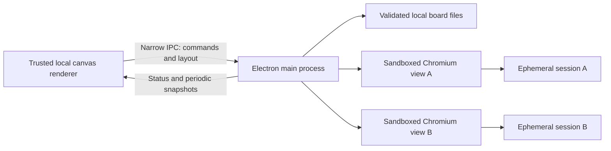

# ADR-001: Native Chromium views on a spatial canvas

**Status:** Accepted for prototype; production hardening pending  
**Date:** 2026-11-07  
**Decider:** Prototype implementation; product and security review required before release

## Context

Web Canvas must browse arbitrary HTTP(S) sites with normal page input, navigation, and independent lifetimes. A Windows-first implementation should retain a credible macOS/Linux path. A canvas also needs transforms, stacking, annotations, and presentation navigation—features that do not map directly to native browser view composition.

## Options considered

| Option | Strengths | Costs and limits |
| --- | --- | --- |
| Electron + `WebContentsView` | Bundled Chromium; native page input; full navigation APIs; shared desktop implementation | Larger distribution and memory footprint; app must ship engine security updates; native views are outside the DOM |
| WebView2 + WinUI/DirectComposition | Strong Windows integration; Evergreen runtime can service its engine | Windows-specific host/composition/input integration; other platforms need another engine adapter |
| Tauri + platform webviews | Smaller application package; Rust host | Engines differ by OS; multiple-view composition and behavior need platform testing and adapters |
| Electron `<webview>` | Convenient DOM placement and transforms | Electron advises alternatives because of stability/architecture concerns |
| Ordinary web app with iframes | Easy CSS transforms and distribution | Site framing policies block many destinations; cross-origin history and navigation control are restricted |
| CEF/offscreen Chromium textures | Fine control of rendering and canvas transforms | Larger native engineering scope: GPU textures, input/IME, accessibility, popups, security servicing, and platform packaging |

## Decision

Use Electron 45.2.3 with native `WebContentsView` objects. Keep all untrusted content out of the application renderer. Avoid the deprecated BrowserView API and do not disable framing or certificate protections.

The renderer owns board data, selection, annotations, and the camera. Main owns the native views and their lifecycle. Only the exact local shell's main frame can send commands. Main validates every board, checks all navigation requests, caps geometry/resources, and handles file dialogs; remote pages receive no application bridge.

Positions are world coordinates. The shell sends a geometry-only update once per animation frame. Main maps each browser content rectangle into window DIPs and checks whether it is fully contained and free of higher board objects or app controls. Native views never intentionally extend into app chrome. The renderer reserves the top 84 world units of each browser card for its trusted controls.

## MVP and acceptance boundaries

- Up to eight websites and 60 total objects per board; individual browser cards up to 1800 × 1400 world units.
- HTTP(S) URL entry; independent browser controls; move, resize, raise, duplicate, delete, arrange, pan, zoom, fit, outline, and minimap.
- Editable notes, text, rounded rectangle shapes, and embedded raster images.
- Versioned JSON board files and a single debounced recovery copy; atomic temporary-file replacement in the desktop host.
- Presentation stops follow object list order. The current stop is raised for display without rewriting that order; live websites retain input.
- Node tests exercise model/security policy and coordinate cases. An opt-in desktop smoke test uses a local server with `X-Frame-Options: DENY` to prove these are top-level native views, tests input/history/session separation, and checks destruction. Native smoke execution is required before claiming desktop validation.

Out of scope: collaboration, connectors, arbitrary rotations, connectors between nodes, grouping, persistent profiles/passwords, browser extensions, downloads, a permission-granting UI, cloud boards, custom presentation ordering, signed installers, and automatic engine updates.

## Composition, zoom, and resource trade-offs

Native views do not inherit CSS transforms. At camera scale 0.5–1.75, eligible views receive scaled pixel bounds and Chromium page zoom. This preserves native hit testing, keyboard, selection, and IME, but resizing/rounding/responsive CSS can change layout. A card is not a GPU texture that can be continuously transformed or clipped by the DOM.

The 0.25–0.49 overview range, drag operations, partially clipped cards, overlapping higher objects, and shell overlays use labeled snapshots instead. A capture is requested after loading, when a live page becomes hidden, and approximately every eight seconds for hidden pages. Captures are ephemeral; only URLs are persisted. Snapshot generation is best-effort. Video/protected content may not capture, and captures are not synchronized across pages.

Hiding a view retains its page and session. Background throttling is enabled, but hidden scripts, audio, sockets, service workers, and memory do not vanish. The eight-view cap bounds the MVP, not a production resource budget. Closing a card closes its WebContents, clears its session storage, and closes connections. Production needs measured memory/GPU budgets, capture scheduling, suspend/resume, and opt-in session restoration.

## Security decisions

Use `app.enableSandbox()`, `sandbox: true`, `contextIsolation: true`, `nodeIntegration: false`, `webSecurity: true`, no insecure-content overrides, and no remote preload. Each card has a unique nonpersistent partition: cookies/storage do not flow to another card, and Chromium's origin zoom policy does not couple their zoom levels. This is session separation, not a guarantee of one OS process per site; Chromium manages process allocation and its sandbox/site isolation.

Only HTTP(S) main-frame navigation is accepted. Popups and embedded Electron webviews are denied. Sessions deny permission checks/requests and device permissions; downloads are canceled. HTTP-auth challenges are canceled. Certificate errors use Chromium's normal failure behavior; there is no bypass. The shell itself cannot navigate to remote content, and its CSP prohibits frames, plugins, inline scripts, and network connections. Imported labels are escaped or rendered with `textContent`; imported images are restricted to bounded raster data URLs.

Residual risks include Electron/Chromium vulnerabilities, hostile web pages, CPU/memory exhaustion, local-network access by visited sites, site phishing, browser file-picker behavior, unencrypted HTTP, and private data in board/recovery files. Board opening loads its saved destinations and does not create a privacy boundary. Blocking permissions is intentionally coarse; it also breaks legitimate workflows. Browser full-screen capture, secure persistent profiles, OAuth popups, external schemes, and per-origin permission grants need a separate design before implementation.

## Consequences and next steps

The prototype uses one engine across desktop platforms and keeps native input semantics. It pays a clear composition cost: some cards are snapshots, even at an otherwise live zoom. The browser adapter boundary is main-process code; a future WebView2 or offscreen renderer can replace it without changing the board format.

Before a release: execute native integration and hostile-site tests on Windows; verify display scaling/resize/IME/accessibility and fullscreen/media behavior; check macOS/Linux native bounds; measure eight-view workloads; produce a lockfile and dependency audit; implement updates, signing, and secure profile/permission UX. A WebView2 composition spike is warranted if native Windows integration outweighs the cross-platform engine consistency.

## Sources

- [Electron Web Embeds](https://www.electronjs.org/docs/latest/tutorial/web-embeds): embedding choices and native/DOM coordination.
- [WebContentsView](https://www.electronjs.org/docs/latest/api/web-contents-view) and [View](https://www.electronjs.org/docs/latest/api/view): native view ownership, bounds, and visibility.
- [Electron webContents](https://www.electronjs.org/docs/latest/api/web-contents): page capture, page zoom, history, and lifecycle APIs.
- [Electron Security](https://www.electronjs.org/docs/latest/tutorial/security) and [sandboxing](https://www.electronjs.org/docs/latest/tutorial/sandbox/): isolation and security servicing responsibilities.
- [WebView2 API overview](https://learn.microsoft.com/en-us/microsoft-edge/webview2/concepts/overview-features-apis) and [distribution](https://learn.microsoft.com/en-us/microsoft-edge/webview2/concepts/distribution): composition and runtime deployment.
